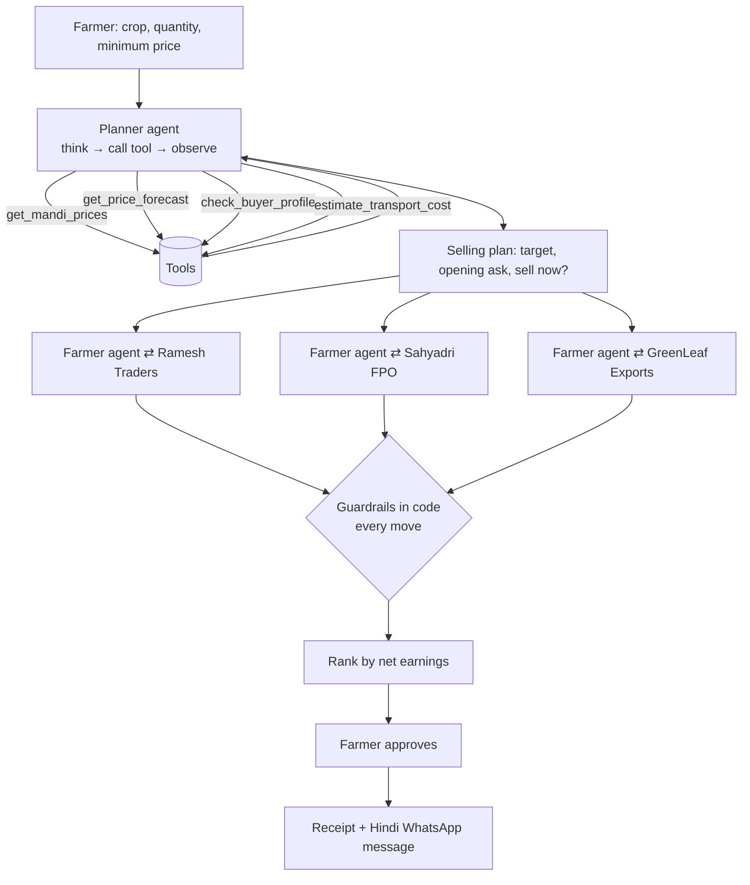

# Mandi Saathi (मंडी साथी)

**An AI agent that researches, negotiates and closes crop deals for Indian farmers.**

Built for **Bharat Agentic 2026** (AgriTech + Bharat Languages).

---

## The problem

Small farmers usually sell to the first local trader who makes an offer. They rarely know today's prices in nearby mandis, they can't compare buyers on what actually reaches their hand after transport and late payment, and negotiating with many buyers takes time and leverage they don't have. Middlemen keep the difference.

## The solution

The farmer enters three things: **crop, quantity, and the lowest price they will accept**. Mandi Saathi does the rest:

1. **Researches** with tools: mandi prices, 7-day trend, every buyer's rating and payment terms, transport cost.
2. **Plans**: a target price, an opening ask, and whether to sell now or wait.
3. **Negotiates with 3 buyers in parallel**, speaking Hindi to them, conceding slowly, using the best mandi price as leverage.
4. **Enforces safety rules in code**: it can never offer or accept below the farmer's minimum, whatever the LLM says.
5. **Ranks deals by net earnings** (price − transport − cost of waiting for payment), not by headline price.
6. **Waits for the farmer's approval**, then issues a receipt and a ready-to-send WhatsApp confirmation in Hindi.

In the demo, the exporter offers the highest price, but the FPO puts more money in the farmer's hand. The agent picks the FPO and explains why.

## Agent workflow



Every step streams live to the browser over Server-Sent Events, so you can watch the agent think, call tools, and bargain.

### Agentic capabilities

| Capability | Where |
|---|---|
| Reasoning and planning | `server/src/agents/planner.js`: ReAct loop that picks its own tools and must gather required information before it may finish |
| Tool use | `server/src/tools.js`: 4 tools with validated inputs; buyers' secret limits are never exposed |
| Multi-agent, multi-step | `server/src/agents/negotiation.js`: up to 6 rounds × 3 buyers, run in parallel |
| Safe actions | `server/src/guardrails.js`: floor and ceiling enforced after every LLM move |
| Human in the loop | `POST /api/approve`: server-side session; nothing is final without approval |
| Resilience | If the LLM times out, rate-limits or returns bad JSON, rule-based agents take over for that step, and the UI says so |

## Tech stack

- **Frontend:** React 18, Vite
- **Backend:** Node.js 20, Express, Server-Sent Events
- **LLM:** Groq (Qwen 3.8 27B) in JSON mode
- **Hardening:** Helmet (CSP), rate limiting, input validation, request timeouts with retry, graceful shutdown, structured JSON logs
- **Tests:** Node's built-in test runner (guardrails, scoring, full sessions across all crops)
- **Deploy:** Render (one service) or Docker

## Run locally

Requires Node 18.17+.

```bash
npm run install:all
cp server/.env.example server/.env      # add your GROQ_API_KEY (free at console.groq.com)

npm run dev:server     # http://localhost:3001
npm run dev:client     # http://localhost:5173
```

No API key? It runs in **offline demo mode** with rule-based agents, so the demo always works.

Run the tests:

```bash
npm test
```

## Deploy (Render)

1. Push this repo to GitHub.
2. On Render: **New → Blueprint**, pick the repo (uses `render.yaml`).
3. Set `GROQ_API_KEY` in the environment.
4. Open the URL. The server serves the built frontend and the API from one origin.

Free Render instances sleep when idle; the first request can take about 30 seconds.

Or with Docker:

```bash
docker build -t mandi-saathi .
docker run -p 3001:3001 -e GROQ_API_KEY=your_key mandi-saathi
```

## API

| Method | Path | Purpose |
|---|---|---|
| GET | `/api/health` | `{ ok, live }` |
| GET | `/api/meta` | Crops, buyers, farm location, mode |
| GET | `/api/negotiate?crop=onion&quantity=40&floor=1700` | Runs the full agent session as an SSE stream |
| POST | `/api/approve` | `{ sessionId, buyerId }` → receipt, Hindi message, WhatsApp link |

Stream events: `session`, `status`, `thought`, `tool`, `plan`, `msg`, `guardrail`, `notice`, `result`, `decision`, `error`, `done`.

## Project structure

```
server/
  src/
    agents/        planner, negotiation, prompts, rule-based fallback
    app.js         routes, SSE, security middleware
    config.js      environment
    data.js        sample market data
    guardrails.js  safety rules enforced in code
    scoring.js     net-earnings ranking
    session.js     research → plan → negotiate → decide
    store.js       session store for approvals (TTL)
    tools.js       the agent's tools
  test/
client/
  src/
    components/    input, agent reasoning, plan, buyer columns, deal panel
    hooks/         live stream state
```

## Data disclosure

Mandi prices, price trends, buyers and distances are **sample data** for the demo. Tool outputs use the same shape a real integration would return, so connecting eNAM / Agmarknet only changes `tools.js`.

## Roadmap

- Live prices from eNAM / Agmarknet (data.gov.in)
- WhatsApp and voice interface for farmers (Hindi, Marathi and more)
- Real buyer side: traders and FPOs answer through WhatsApp; the farmer's agent stays the same
- Persistent store (Postgres/Redis) and buyer reputation from completed deals

## Originality

All application code was written during the hackathon on 1 October 2026. Third-party software: React, Vite, Express, Helmet, express-rate-limit, cors, dotenv, and the Groq API.
# mandi-saathi
